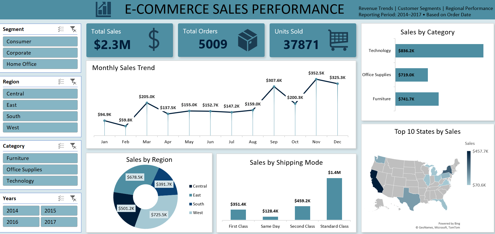
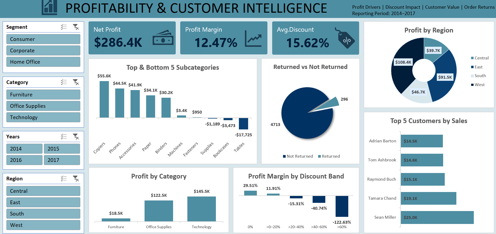

# E-Commerce Profitability & Customer Intelligence

**Excel Data Analytics Portfolio Project | US Superstore | 2014–2017**

## Project overview

This project analyzes retail transaction data to evaluate sales performance, profit margins, discount patterns, regional performance, and order returns. Two interactive Excel dashboards—**Sales** and **Profitability**—support business monitoring and highlight areas for further investigation.

## Business problem

Strong sales do not always translate into strong profits. Management needs to understand which categories, products, regions, and discount levels contribute to profitability, where losses occur, and which areas deserve further investigation.

## Objectives

- Measure sales, profit, and profit margin across categories and regions.
- Identify loss-making subcategories and discount bands.
- Compare regional profitability and category contributions.
- Quantify the proportion of distinct orders marked as returned.
- Recommend focused, evidence-based follow-up analyses.

## Dataset

The workbook contains **9,994 order-line records**, **5,009 distinct orders**, and transactions from **2014–2017**. The source workbook includes `Orders`, `Returns`, and `People` tables. Important fields include Order ID, Order Date, Customer, Segment, Region, Category, Sub-Category, Sales, Quantity, Discount, and Profit. The Orders sheet also includes derived `Discount_Band` and `ROV` fields.

> **Data context:** This is a historical US Superstore practice dataset. Results demonstrate analytical methods; they are not current operational performance. Monetary amounts are shown in USD.

## Tools and approach

- **Microsoft Excel:** PivotTables, PivotCharts, slicers, calculated KPIs, and dashboards.
- **Data preparation:** Checked data quality and duplicates, and organized transaction and return information for analysis.
- **Analysis:** Aggregated sales and profit by category, subcategory, region, and discount band; calculated profit margins as `SUM(Profit) / SUM(Sales)`.
- **Returns:** Counted distinct Order IDs and matched them to the Returns list to calculate the order return rate.

## Dashboard previews

Sales_Dashboard

  

Profit_Dashboard

  

## Performance snapshot

| KPI | Result |
|---|---:|
| Total sales | $2,296,919.49 |
| Total profit | $286,409.08 |
| Overall profit margin | 12.47% |
| Order-line records | 9,994 |
| Distinct orders | 5,009 |
| Returned orders | 296 |
| Order return rate | 5.91% |

## Key findings and business recommendations

### 1. Furniture has weak profitability
**Finding:** Furniture generated **$741,718** in sales but only **$18,463** in profit, a margin of **2.49%**.

**Business insight:** Furniture contributes substantial revenue but converts much less of it into profit than Technology or Office Supplies.

**Recommendation:** Investigate discount levels, pricing, costs, and loss-making Furniture products before pursuing volume growth.

### 2. Three subcategories are loss-making
**Finding:** Tables lost approximately **$17,725**, Bookcases **$3,473**, and Supplies **$1,189**.

**Business insight:** These losses offset profits generated by other subcategories.

**Recommendation:** Investigate individual products and transactions, including discounts and cost structure, to determine where intervention may be warranted.

### 3. Higher discount bands have negative aggregate margins
**Finding:** The **0%** and **>0–20%** discount bands have positive aggregate profit margins of **29.51%** and **11.91%**. The **>20–40%**, **>40–60%**, and **>60%** bands have margins of **−15.31%**, **−40.74%**, and **−122.63%**, respectively.

**Business insight:** Heavy discounts are associated with weaker profitability in this dataset. This association does not by itself establish causation.

**Recommendation:** Review loss-making high-discount transactions and test discount-policy adjustments while monitoring both sales and profit.

### 4. Central is the weakest region by profit margin
**Finding:** Central's margin is **7.92%**, compared with **14.94%** in West, **13.49%** in East, and **11.93%** in South.

**Business insight:** Central converts a smaller proportion of its sales into profit than the other regions.

**Recommendation:** Compare Central's product mix, discount practices, and loss-making subcategories with better-performing regions.

### 5. Technology contributes the most profit
**Finding:** Technology generated **$145,455**, approximately **50.8%** of total profit. Office Supplies contributed approximately **42.8%**, and Furniture **6.4%**.

**Business insight:** Technology and Office Supplies account for most of the company's profitability.

**Recommendation:** Maintain profitability in strong categories while exploring ways to improve weaker margins elsewhere.

### 6. About 5.91% of distinct orders were returned
**Finding:** **296 of 5,009** distinct orders are marked as returned.

**Business insight:** Returns affect a measurable share of orders, but the dataset does not establish return reasons or the financial impact of those returns.

**Recommendation:** Analyze returns by category, product, region, and segment; collect return reasons and cost data before drawing conclusions about causes or losses.

## Business conclusion

The business is profitable overall, but profitability is uneven across categories, regions, and discount levels. Priority follow-up work should examine high-discount losses, Tables and Bookcases, and the Central region. Decisions should be based on validated drivers of profitability rather than sales volume alone.

## Limitations

- Historical sample data may not reflect a live business.
- Discount-profit relationships are observational and do not prove causation.
- Return reasons and return-handling costs are unavailable; the return rate is based on distinct orders, not line items.
- Recommendations require additional analysis or controlled testing before implementation.

## Repository contents

```text
E-Commerce-Profitability-Analysis/
├── README.md
├── E-Commerce_Analysis.xlsx
├── Sales_Dashboard.png
└── Profit_Dashboard.png
```

## Skills demonstrated

Excel data cleaning, PivotTables, PivotCharts, interactive dashboards, KPI design, profitability analysis, segmentation, data interpretation, and business communication.
